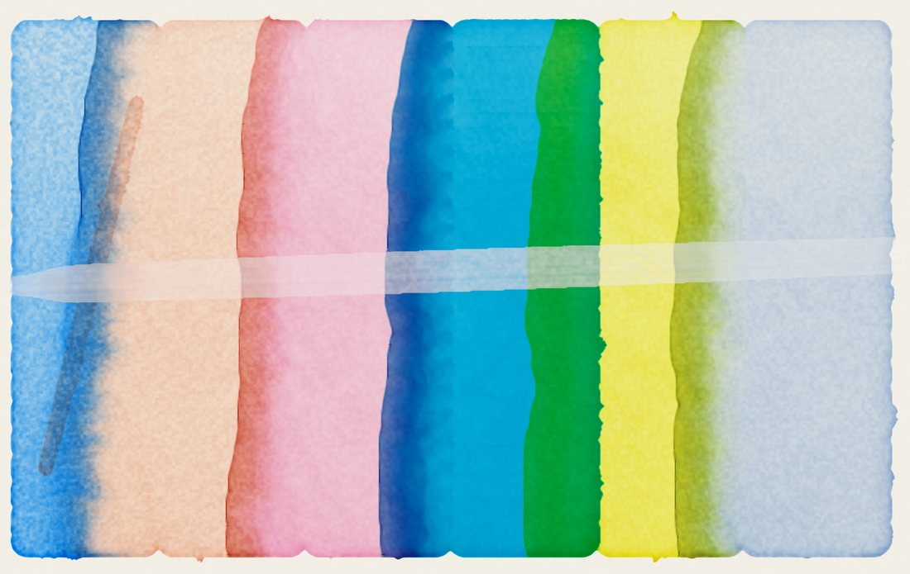

  

<h1 align="center">Inksumi</h1>

  <strong>Aquarelle et encre simulées, sur iPad</strong> · <em>Simulated watercolor and ink, on iPad</em>

  
  
  

  <a href="https://jeromehouix.github.io/inksumi-site/"><strong>Site</strong></a> ·
  <a href="CHANGELOG.md">Nouveautés / Changelog</a> ·
  <a href="https://jeromehouix.github.io/inksumi-site/#confidentialite">Confidentialité / Privacy</a> ·
  <a href="https://github.com/jeromehouix/inksumi-site/issues/new/choose">Contact</a>

  

<a href="#français">Français</a> · <a href="#english">English</a>

---

## Français

Inksumi est un atelier de peinture pour iPad où la matière est simulée :
l'eau coule, le pigment se dépose, le papier boit. On y peint à l'aquarelle
et à l'encre, mais aussi à la gouache, à l'acrylique et aux bâtons secs, sur
des papiers qui ont chacun leur caractère.

**Bientôt sur l'App Store.**

### Ce qu'on y fait

- **L'aquarelle** — mouillé sur mouillé, fondus, auréoles, bords foncés,
  granulation : tout naît de l'eau qui coule et sèche sur le grain du
  papier ; un pinceau fait de poils qui se couchent, s'ouvrent et se vident.
- **L'encre et le sumi** — le sumi en tons, la pointe qui se fend, la brosse
  sèche ; des encres de couleur qui se séparent dans le mouillé.
- **Gouache, acrylique, bâtons secs** — la pâte qui épouse la dent du
  papier, le film de l'acrylique, crayon, pastel, craie et fusain qui fusent
  dans un lavis humide ; des couleurs qui se mêlent comme des pigments.
- **Trois ateliers japonais** — suminagashi (l'encre sur l'eau), mokuhanga
  (la gravure sur bois), orizomegami (le papier plié-teint).
- **Des papiers, des carnets** — grain torchon, grain fin, Xuan, Yupo,
  toile ; des carnets et des leporellos qui deviennent des livres en PDF ou
  en EPUB ; pour le tirage, un TIFF 16 bits ou un PSD calqué.

### En bref

| | |
| --- | --- |
| Appareil | iPad avec iPadOS 26 ; conseillé : iPad (10e génération) ou plus récent |
| Stylet | Apple Pencil ou autre stylet, avec ou sans pression ; tout se mène aussi au doigt |
| Langues | français, anglais, espagnol, allemand, italien, portugais, néerlandais, japonais, chinois simplifié, coréen |
| Exports | PNG, TIFF 16 bits, PSD calqué, PDF, EPUB, time-lapse |
| Confidentialité | Aucun compte, aucun suivi, aucune donnée collectée ; vos feuilles restent sur votre iPad |

### Nous écrire

Les formulaires s'ouvrent sur GitHub, où un compte gratuit est nécessaire
pour écrire. Les messages sont publics : n'y mettez aucune information
personnelle.

- [Poser une question](https://github.com/jeromehouix/inksumi-site/issues/new?template=question.yml)
- [Signaler un problème](https://github.com/jeromehouix/inksumi-site/issues/new?template=probleme.yml)
- [Proposer une idée](https://github.com/jeromehouix/inksumi-site/issues/new?template=idee.yml)
- [Une demande sur la confidentialité](https://github.com/jeromehouix/inksumi-site/issues/new?template=confidentialite.yml)

Voir aussi [l'aide](.github/SUPPORT.md), [comment contribuer](.github/CONTRIBUTING.md)
et [la sécurité](.github/SECURITY.md).

---

## English

Inksumi is a painting studio for iPad where the medium is simulated: water
flows, pigment settles, paper drinks. You paint in watercolor and ink, and
also in gouache, acrylic and dry media, on papers that each have their own
character.

**Coming soon to the App Store.**

### What you can do

- **Watercolor** — wet-in-wet, soft blends, blooms, dark edges,
  granulation: everything comes from water flowing and drying on the grain
  of the paper; a brush made of hairs that bend, spread and run dry.
- **Ink and sumi** — sumi in tones, a tip that splits, the dry brush;
  colored inks that separate in the wet.
- **Gouache, acrylic, dry media** — paint that follows the tooth of the
  paper, the acrylic film, pencil, pastel, chalk and charcoal bleeding into
  a damp wash; colors that mix like pigments.
- **Three Japanese workshops** — suminagashi (ink on water), mokuhanga
  (woodblock printing), orizomegami (fold-dyed paper).
- **Papers and sketchbooks** — rough, fine grain, Xuan, Yupo, canvas;
  sketchbooks and leporellos that become PDF or EPUB books; for printing, a
  16-bit TIFF or a layered PSD.

### At a glance

| | |
| --- | --- |
| Device | iPad with iPadOS 26; recommended: iPad (10th generation) or later |
| Stylus | Apple Pencil or another stylus, with or without pressure; everything also works with a finger |
| Languages | English, French, Spanish, German, Italian, Portuguese, Dutch, Japanese, Simplified Chinese, Korean |
| Exports | PNG, 16-bit TIFF, layered PSD, PDF, EPUB, time-lapse |
| Privacy | No account, no tracking, no data collected; your sheets stay on your iPad |

### Get in touch

The forms open on GitHub, where a free account is needed to write. Messages
are public: do not include any personal information.

- [Ask a question](https://github.com/jeromehouix/inksumi-site/issues/new?template=question.yml)
- [Report a problem](https://github.com/jeromehouix/inksumi-site/issues/new?template=probleme.yml)
- [Suggest an idea](https://github.com/jeromehouix/inksumi-site/issues/new?template=idee.yml)
- [A privacy request](https://github.com/jeromehouix/inksumi-site/issues/new?template=confidentialite.yml)

See also [support](.github/SUPPORT.md), [contributing](.github/CONTRIBUTING.md)
and [security](.github/SECURITY.md).

---

## Ce dépôt / This repository

Ce dépôt contient le site public d'Inksumi, publié par GitHub Pages ; le code
de l'application n'est pas public. *This repository holds Inksumi's public
website, served by GitHub Pages; the app's source code is not public.*

| Fichier / File | Rôle / Purpose |
| --- | --- |
| `index.html` | La page en français : présentation, confidentialité, feuilles, conditions, mentions légales, contact / *The page in French* |
| `<langue>/index.html` | La même page dans les neuf autres langues / *The same page in the nine other languages* |
| `img/` | Les planches de la présentation, peintes par le moteur d'Inksumi / *The presentation plates, painted by the Inksumi engine* |
| `enso.png` | L'ensō de l'icône / *The ensō of the app icon* |
| `CHANGELOG.md` | Les nouveautés de chaque version / *What's new in each version* |
| `.github/ISSUE_TEMPLATE/` | Les formulaires de contact / *The contact forms* |

Les pages sont générées depuis les textes de l'application (la page « À
propos », dans chaque langue) : on ne les modifie pas à la main. *The pages
are generated from the app's own texts and are not edited by hand.*

---

© 2026 Jérôme Houix — Inksumi. Tous droits réservés / All rights reserved
([LICENSE](LICENSE)).
